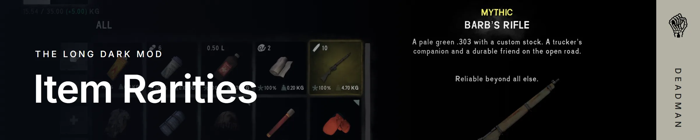

     

Item Rarities is a [MelonLoader](https://github.com/LavaGang/MelonLoader) mod for [The Long Dark](https://www.hinterlandgames.com/the-long-dark/) that gives each item a rarity, from Common to Mythic, so the rare finds feel rare. Every menu shows an item's rarity in its colour, and you can sort by it.

## Install

1. Install [MelonLoader](https://github.com/LavaGang/MelonLoader/releases/latest/download/MelonLoader.Installer.exe) into The Long Dark.
2. Install the mods it needs, in the `Mods` folder in the game's folder:
   - [Complex Logger](https://github.com/Arkhorse/Complex-Logger/releases/latest)
   - [ModSettings](https://github.com/DigitalzombieTLD/ModSettings), for the mod's settings menu (Complex Logger needs it too)
   - [ModComponent](https://github.com/dommrogers/ModComponent/releases/latest), for the mod's translations
3. Download [ItemRarities.dll](https://github.com/Deaadman/item-rarities/releases/latest/download/ItemRarities.dll) and put it in the `Mods` folder too.
4. Start the game.

To update, replace `ItemRarities.dll` with the new one. To uninstall, delete it.

Each release says which version of The Long Dark it was made for. After a game update, the mod may not work until it's updated too.

### Nightly builds

Every change is built straight away and published as the [nightly release](https://github.com/Deaadman/item-rarities/releases/tag/nightly). It has the newest fixes and features, but it may be unstable. Back up your saves first.

## What it does

| Where | What you see |
| --- | --- |
| Inventory | The selected item's rarity above its name, and its square and highlight in the rarity's colour. A star button sorts by rarity; press it again to flip the order. |
| Containers | The selected item's highlight in its rarity's colour, and the same sort button for both sides. |
| Clothing | Each slot in its item's rarity's colour, when selected or hovered over. |
| Radial menu | The hovered item's rarity above its name, and its segment in the rarity's colour. |
| Inspecting | The rarity fades in with the rest of the item's details. |
| In the world | The name of the item under your crosshair in its rarity's colour. |
| Crafting, cooking, milling and examining | The selected item's rarity above its name. |
| Settings | Your own colour for each rarity. |
| Other mods | Their items can have a rarity too, with the [ModComponent SDK](https://github.com/Deaadman/mod-component-sdk) or a line of code. |

Mythic items' labels glow. [How it works](docs/features.md) has every rarity, setting and colour, and how other mods give their items a rarity.

## Bugs and ideas

Found a bug? Use the [bug report form](https://github.com/Deaadman/item-rarities/issues/new?template=bug_report.yml). It asks for `MelonLoader\Latest.log` from your game's folder, with every level turned on in Complex Logger's settings.

Have an idea? Use the [feature request form](https://github.com/Deaadman/item-rarities/issues/new?template=feature_request.yml).

## Learn more

- [How it works](docs/features.md): the rarities, the settings, and giving other mods' items a rarity
- [Building from source](docs/development.md)
- [Changelog](CHANGELOG.md)

## Thanks

For the translations:

- [deepsnowland](https://github.com/deepsnowland), Japanese
- [Elderly-Emre](https://github.com/Elderly-Emre), Turkish
- [ERRORES241](https://github.com/ERRORES241), Ukrainian
- Laki, Polish
- [LettereUniche](https://github.com/LettereUniche), Italian
- [Lev234](https://github.com/Lev234), Russian
- LordKai1102, German
- [Mezav23](https://github.com/mezav23), Spanish
- [WPNsmglr](https://github.com/WPNsmglr), Traditional Chinese

## License

Item Rarities is licensed under [GPL-3.0](LICENSE).

## Disclaimers

**AI assistance.** Parts of this project, including some of its code, were written with the help of AI coding agents.

**Not affiliated with Hinterland.** Item Rarities is an unofficial fan-made mod. It isn't made, endorsed or supported by Hinterland Studio. The Long Dark and its assets are the property of Hinterland Studio. Please report problems with the mod here, not to Hinterland.
